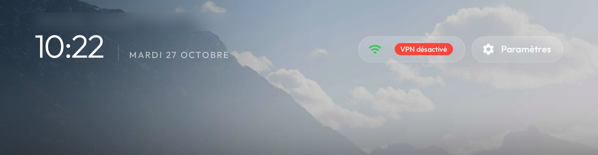
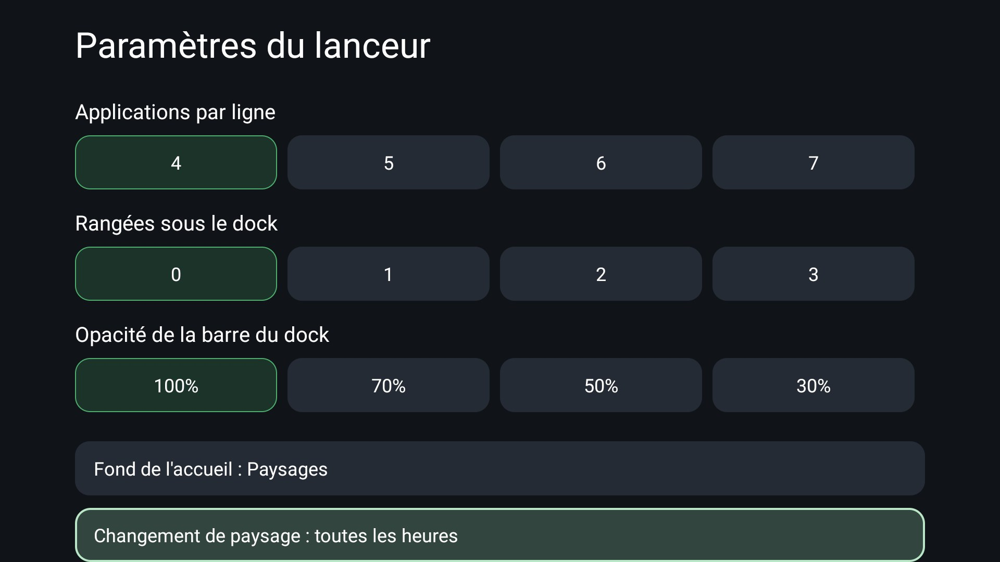

<h1 align="center">Hearth Home</h1>

<p align="center">
  <b>A calm, beautiful home screen for Android TV: landscapes that fade into the room, no ads, no clutter.</b>
</p>

<p align="center"></p>

<p align="center">
  <a href="../../releases/latest"><b>Download</b></a> ·
  <a href="#install">Install</a> ·
  <a href="#settings">Settings</a> ·
  <a href="#your-own-wallpapers">Your own wallpapers</a> ·
  <a href="#credits">Credits</a>
</p>

---

Hearth Home is a launcher (the TV's home screen) built on the reference launcher of
[**cleanyourtv**](https://github.com/Gathin23/cleanyourtv) by Gathin, the project that removes the bloat and ads
from smart TVs. It keeps that launcher's spirit (light, no internet permission, no tracking, made for TVs with 1 GB
of RAM) and adds its own look and a few things you use every day. It pairs with
[**Hearth**](https://github.com/depre99ed/hearth-tv), the ad-free video app.

The rest of cleanyourtv (debloat lists for many TVs, tools, the agent prompt) is still here: see
[CLEANYOURTV-README.md](CLEANYOURTV-README.md).

## What it does

- **51 landscapes behind Home**: fjords, mountains, Icelandic shores, forests, deserts, a castle in the clouds…
  Each one shows only in the top of the screen and **fades into the dark** before the apps, so the tiles stay easy
  to read. A new one every hour (or every 15 min, 30 min, 3 h or once a day).
- **Or light halos**: switch to a glow in the colour of the selected app instead of pictures.
- **A waking animation** the first time Home appears after the TV starts: the picture emerges, a band of light
  sweeps across, the clock rises and the tiles settle one after the other.
- **A Settings page made for the remote**: network, Bluetooth (connect, disconnect, forget, pair new devices),
  picture, sound, screensaver, apps, privacy (an ad and tracker blocking DNS in one click) and system, with the TV's
  full settings one row away.
- **Press Home twice** for the apps that are open right now, with a picture of each, to switch or close them.
- Everything from the cleanyourtv launcher: a dock for your favourite apps, the app library, the inputs menu,
  remote buttons you can map to apps, themes.

<p align="center"></p>

## Install

Hearth Home needs Android TV / Google TV 8.0 or newer.

### 1. Install the APK

Download `Hearth-Home-….apk` from [**Releases**](../../releases/latest) and install it like any app:

- **Downloader app** (no computer): install *Downloader* from the Play Store, allow it under *Settings → Device
  Preferences → Security & restrictions → Unknown sources*, then type the APK's address.
- **USB stick**: copy the APK, open it with a file manager (*File Commander*, *X-plore*) allowed in *Unknown sources*.
- **ADB** from a computer (enable developer mode: press OK 7 times on *Build* in *About*, then turn on
  *USB debugging* or *Network debugging*):

```bash
adb connect <tv ip>
adb install Hearth-Home-1.0.apk
```

The package name is `com.gathin.tvhome`, as in cleanyourtv. If the cleanyourtv launcher is already installed,
uninstall it first (they are signed with different keys).

### 2. Make it your Home

Most Android TVs have no "choose your home app" screen, so this step uses ADB. Keep your stock launcher until
Hearth Home is confirmed as Home:

```bash
adb shell cmd package set-home-activity com.gathin.tvhome/.MainActivity
adb shell input keyevent HOME
```

If the stock home still comes back when you press Home, disable it, **only after** Hearth Home opened fine:

```bash
# Android TV
adb shell pm disable-user --user 0 com.google.android.tvlauncher
# Google TV
adb shell pm disable-user --user 0 com.google.android.apps.tv.launcherx
# Undo (either one)
adb shell pm enable com.google.android.tvlauncher
```

On TVs from some brands the stock launcher has another name, and on some (CVTE boards, Google TV with
"setupwraith") disabling it needs care: cleanyourtv's [PROMPT.md](PROMPT.md) and
[`launcher/build-and-install.sh`](launcher/build-and-install.sh) handle those cases safely.

### 3. Turn on the extras (optional)

These let the Settings page change system settings, show the open apps and catch the remote's Home and extra buttons:

```bash
adb shell pm grant com.gathin.tvhome android.permission.WRITE_SECURE_SETTINGS
adb shell pm grant com.gathin.tvhome android.permission.DUMP
adb shell pm grant com.gathin.tvhome android.permission.PACKAGE_USAGE_STATS
adb shell appops set com.gathin.tvhome GET_USAGE_STATS allow
adb shell appops set com.gathin.tvhome WRITE_SETTINGS allow
adb shell settings put secure enabled_accessibility_services com.gathin.tvhome/.InputKeyService
adb shell settings put secure accessibility_enabled 1
```

Then turn network debugging off again: port 5555 is not encrypted.

## Settings

Open **Settings** (top right) → **Apps** → **Home screen settings**:

| Setting | What it does |
|---|---|
| **Home background** | *Pictures* (the landscapes) or *Light halos* (a glow in the selected app's colour) |
| **Next picture** | every 15 min, 30 min, hour, 3 h, or once a day |
| **Wallpaper** | keep one landscape instead of the rotation, or none |
| **Add pictures** | how to add your own (below) |
| Apps per row, rows below the dock, dock opacity, animations | as in cleanyourtv |

## Your own wallpapers

Hearth Home reads its pictures from a **theme** (see [themes/README.md](themes/README.md)). To use your own:

1. Fade your pictures like the bundled ones (Python 3 with Pillow: `pip install pillow`):

```bash
python tools/hearth/fade_wallpaper.py my-photo.jpg mytheme/wallpapers/001.jpg
```

2. Put a `config.json` in `mytheme/`:

```json
{ "wallpaper": true, "wallpaper_rotation_minutes": 60, "wallpaper_true_color": true,
  "background_color": "#0A0B0F", "ambient_glow": false, "fade_rows": true }
```

3. Send it to the TV over ADB (it replaces the bundled set; `-Reset` goes back):

```bash
# Windows
tools\theme.ps1 -TvHost <tv ip> mytheme
# macOS / Linux
TV_HOST=<tv ip> tools/theme.sh mytheme
```

## Build it yourself

JDK 17, Android SDK platform 34 and build-tools 34.0.0. In `launcher/`:

```bash
./gradlew --no-daemon testReleaseUnitTest assembleRelease
```

To get a signed APK like the released one, from the repository's root (Windows: `tools\hearth\build-release.ps1`):

```bash
keytool -genkeypair -keystore hearth.jks -alias hearth -keyalg RSA -keysize 3072 -validity 10000
export HEARTH_KEYSTORE=$PWD/hearth.jks HEARTH_KEY_ALIAS=hearth HEARTH_KEY_PASSWORD=<your password>
tools/hearth/build-release.sh     # out/Hearth-Home.apk
```

The new parts are in `launcher/app/src/main/java/com/gathin/tvhome/`: `WallpaperSeed` (the bundled landscapes on
first start), `HomeAwakening`, `SettingsHubActivity`, `RecentsActivity`, `HomeDoubleTap`, the background settings in
`LauncherSettingsActivity` and `Config`. The pictures are in `launcher/app/src/main/assets/wallpapers/`.

## Credits

- **[cleanyourtv](https://github.com/Gathin23/cleanyourtv)** by **Gathin** and its contributors: the launcher this
  is built on, the debloat lists and the tools (MIT).
- **Photographers** of the 51 landscapes, from [Unsplash](https://unsplash.com) under the Unsplash License: the
  full list is in [docs/hearth/CREDITS-wallpapers.md](docs/hearth/CREDITS-wallpapers.md).
- **Hearth**, the companion ad-free video app (a fork of SmartTube by Yuriy Liskov): [depre99ed/hearth-tv](https://github.com/depre99ed/hearth-tv).

## License

MIT, like cleanyourtv: see [LICENSE](LICENSE). The photos keep their own license (Unsplash License).
